# Melodee shortcuts and controls

A quick reference for every page. The [manual](../web/manual/index.html) explains each one in full; the
[PATTERNS and SONG guide](song-guide/README.md) walks through making a song step by step. The pictures are drawn by
`tools/gen_shortcuts.py`; each button keeps one colour in all of them, on its shortcut keys too. Which knob moves
through pages, rows and options on each screen: [NAVIGATION.md](NAVIGATION.md).

**Terms:** *tap* means press and let go; *hold* means keep it down past HOLD (0.3–0.6 s, set in the menu); *A + B*
means hold A, then press or turn B.

## Everywhere

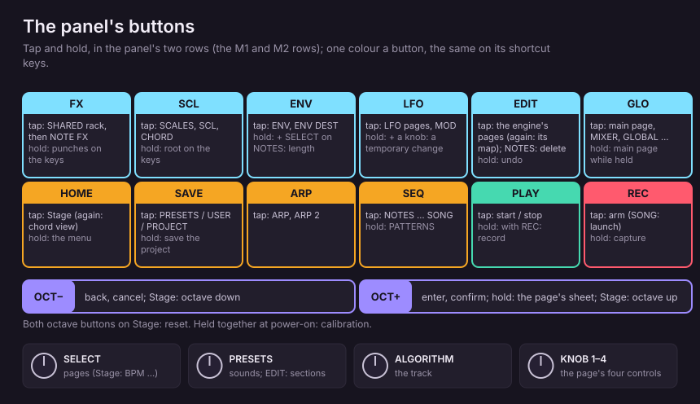

| Control | Does |
|---|---|
| **SELECT** | Turn the pages of the open section, stopping at the first and last (on Stage: the HOME SELECT value, BPM by default); never up and down a list |
| **KNOB 1** | Move across, or edit a value. On list pages **KNOB 2** picks the row, **KNOB 1** sets it |
| **OCT+** | Enter, confirm, or open a sheet |
| **hold OCT+** | The page's sheet of actions (Stage, sound pages, NOTES, PATTERNS, SONG, …) |
| **OCT−** | Back or cancel, the innermost thing first (question, popup, sub-screen), then Stage |
| **ALGORITHM** | Select the track, on every page |
| **PRESETS** | The bigger step: sounds on Stage, the browser and PATTERNS; elsewhere the page's next part (a section, an envelope group, the operator, NOTES' zoom) or the row of a list, sheet, menu, rack or the slots. Nothing to do: **PRESETS: GO TO STAGE** |
| **hold EDIT** | Undo. **EDIT + OCT−** further back, **EDIT + OCT+** redo (eight levels) |
| **HOME** | Stage. **hold HOME**: the settings menu |
| **SAVE** | PRESETS / USER / PROJECT. **hold SAVE** (or **SAVE + REC**): save the project to its slot |
| **hold SEQ** | Straight to PATTERNS |
| **PLAY** | Start / stop. **REC + PLAY**: arm and start recording together |
| **REC** | Arm / disarm the selected track. **hold REC**: capture the last bars you played |
| **a family button again** | Its next page (FX, SCL, ENV, LFO, EDIT, GLO, ARP, SEQ) |
| **OCT− + OCT+ at power-on** | Calibration |

On Stage the octave buttons shift the octave (both together reset it). Everywhere else they are Enter and Esc.

## Keyboard shortcuts (M1, M2, M3)

F5, G5 and F#5 are modifiers and do not play notes.

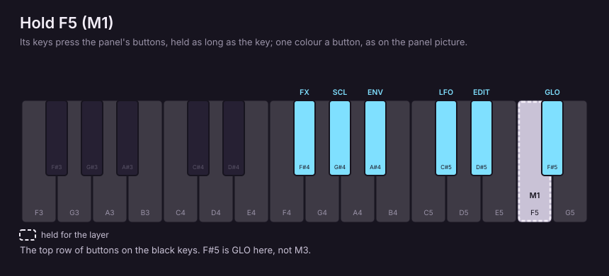

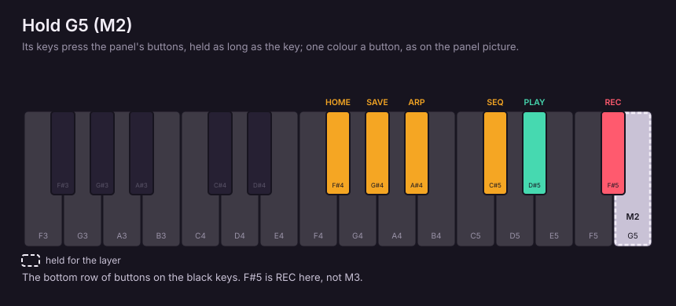

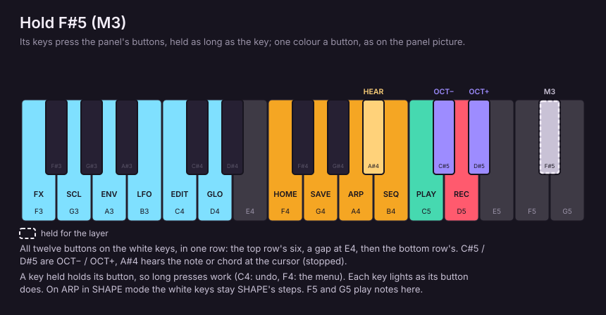

| Hold | Then press | Does |
|---|---|---|
| **F5** (M1) | F#4 G#4 A#4 C#5 D#5 F#5 | FX SCL ENV LFO EDIT GLO |
| **G5** (M2) | F#4 G#4 A#4 C#5 D#5 F#5 | HOME SAVE ARP SEQ PLAY REC |
| **F#5** (M3) | F3 G3 A3 B3 C4 D4 | FX SCL ENV LFO EDIT GLO |
| **F#5** (M3) | F4 G4 A4 B4 C5 D5 (E4 is a gap) | HOME SAVE ARP SEQ PLAY REC |
| **F#5** (M3) | C#5 / D#5 | OCT− / OCT+ |
| **F#5** (M3) | A#4 | Hear the note or chord at the cursor (NOTES, drum grid, DRUM HIT; stopped) |

- A key held with M3 holds its button, so long presses work: **M3 + C4** held is undo, **M3 + F4** held the menu.
- With M3 held, each key lights the way its button does. On ARP in SHAPE mode the white keys stay SHAPE's steps.
- With a momentary edit on (LFO held, a knob turned), **F#5** keeps it, as OCT+ does.

## Hold layers

### GLO (tap: its main page, which stays open; hold: the same while held)

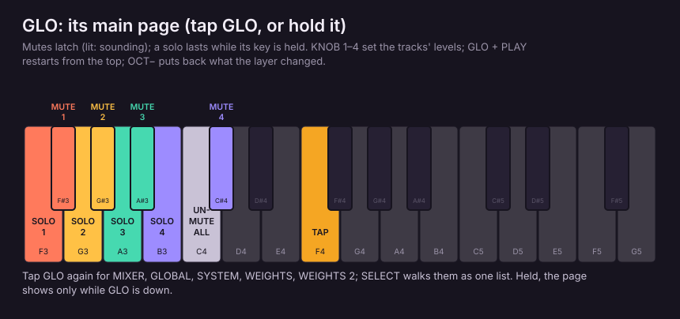

| Control | Does |
|---|---|
| **F#3 G#3 A#3 C#4** | Mute tracks 1–4 (latched; lit = sounding) |
| **F3 G3 A3 B3** | Solo tracks 1–4 while held |
| **C4** | Unmute all |
| **F4** | TAP tempo (internal clock) |
| **KNOB 1–4** | Track 1–4 level |
| **GLO + PLAY** | Restart from the top without stopping |
| **GLO + SELECT** | GLO SELECT (BPM by default; set in the menu) |
| **OCT−** | Put back what the layer changed |
| **GLO again** | MIXER, then GLOBAL, SYSTEM, WEIGHTS, WEIGHTS 2, then the main page |
| **SELECT** | The same six pages as one list, stopping at both ends |

### SCL (hold)

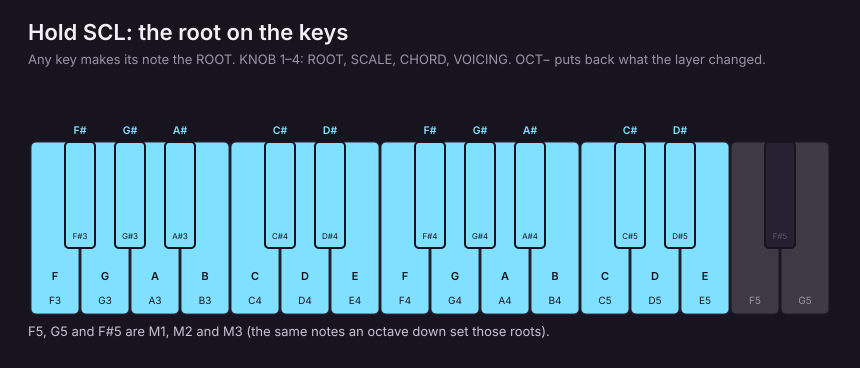

| Control | Does |
|---|---|
| **any key** | Its note becomes ROOT |
| **KNOB 1–4** | ROOT, SCALE, CHORD, VOICING |
| **OCT−** | Put back what the layer changed |

### FX (hold): master punch effects

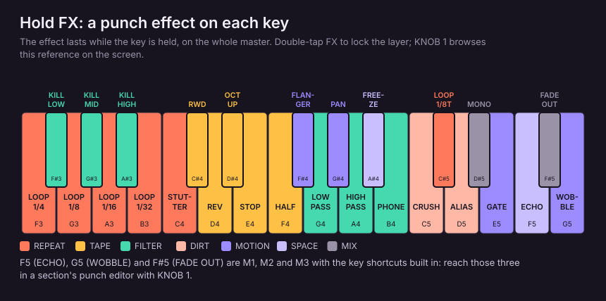

| Control | Does |
|---|---|
| **a key** | Apply one of 27 effects to the master while held |
| **KNOB 1** | Browse the key reference |
| **double-tap FX** | Lock the layer; tap again to close |

While FX is held (or locked) the M-keys step aside: F5 (ECHO), G5 (WOBBLE) and F#5 (FADE OUT) play their effects,
in a section's punch editor too.

### LFO and ENV (hold, temporary changes)

| Control | Does |
|---|---|
| **LFO + a sound or effect knob** | A temporary change, restored when you let go (not recorded as motion) |
| **LFO + knob, then OCT+ (or F#5)** | Keep it (KEPT) |

## Stage (HOME)

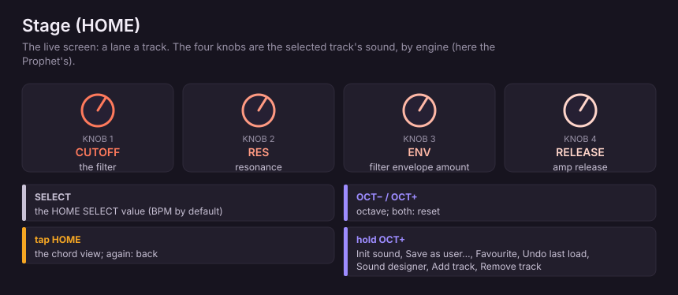

| Control | Does |
|---|---|
| **KNOB 1–4** | The selected track's four sound knobs (by engine, e.g. Prophet CUTOFF RES env amount release) |
| **SELECT** | The HOME SELECT value: BPM, MOD WHEEL, LEVEL, SWING, TRANSPOSE, CHORD, ARP RATE, PATTERN or OFF |
| **OCT− / OCT+** | Octave down / up; both together reset |
| **tap HOME** | The chord view (tap again to return) |
| **hold OCT+** | Init sound, Save as user…, Favourite, Undo last load, Sound designer, Add track, Remove track |

## Sounds

### Browser (PRESETS, or SAVE → PRESETS)

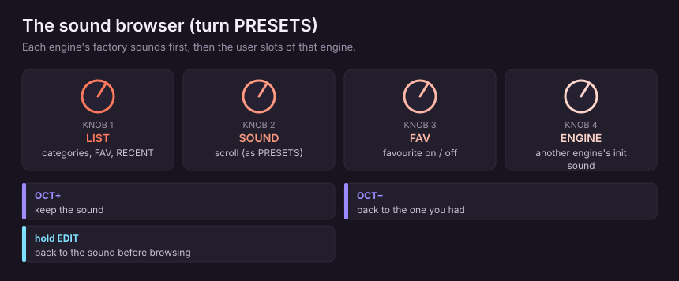

| Control | Does |
|---|---|
| **KNOB 1** | The list: categories, FAV, RECENT |
| **KNOB 2 / PRESETS** | Scroll sounds |
| **KNOB 3** | Favourite on / off |
| **KNOB 4** | Change engine (its init sound) |
| **OCT+ / OCT−** | Keep the browsed sound / go back to the one you had |
| **hold EDIT** | Back to the sound you had before browsing |

### Sound pages

| Control | Does |
|---|---|
| **hold OCT+** | Init sound, Save as user…, Favourite, Undo last load, Sound designer |
| **EDIT** (on an EDIT page) | The section map: **KNOB 1** / **PRESETS** category, **KNOB 2** / **SELECT** page, **OCT+** open, **OCT−** / **EDIT** close |
| **PRESETS** | Jump between sections (FM6: operator, CZ-1: line) |

### USER slots (SAVE → USER)

| Control | Does |
|---|---|
| **KNOB 2 / PRESETS** | Pick a slot, one a detent |
| **KNOB 1** | Ten slots a detent |
| **OCT+** | Its sheet: Load, Save here, Rename, Erase (Send, Import here); **KNOB 2** or **PRESETS** its rows |
| **hold OCT+ + SELECT / KNOB 1 / KNOB 2** | Select a range; then tap **OCT+** for Send selected, Erase selected, Clear selection |

### NAME screen

| Control | Does |
|---|---|
| **white keys** | Type, multi-tap like a phone keypad |
| **black keys** | ←, SPACE, →, DEL, 123 |
| **KNOB 1 / KNOB 2** | Move the cursor / change the character |
| **OCT+ / OCT−** | Save / cancel |

## Projects (SAVE → PROJECT)

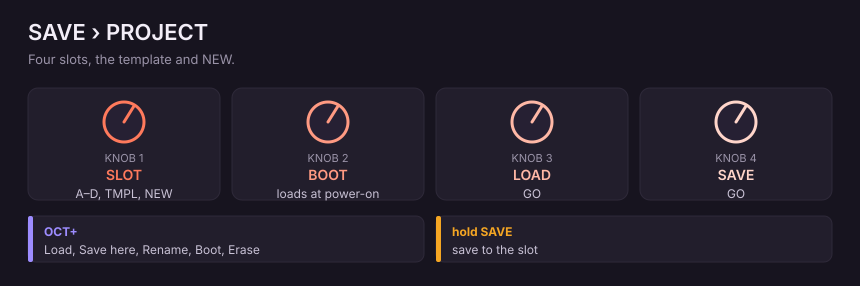

| Control | Does |
|---|---|
| **KNOB 1 / KNOB 2 / PRESETS** | Pick the slot: A–D, TMPL, NEW |
| **OCT+** | The slot's sheet: Load, Save here, Rename, Boot (loads at power-on), Erase |

**NEW** (stopped): **KNOB 1–3** root, scale, tempo, then a role on each knob (--, KEEP, DRUMS, BASS, CHORDS, LEAD, PAD).

## Modulation (ENV, LFO)

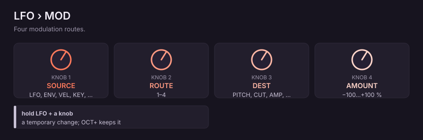

| Page | Knobs |
|---|---|
| **ENV** | ATK DEC SUS REL |
| **ENV DEST** | Filter, pitch, shape amounts |
| **LFO** | RATE WAVE PHS FADE |
| **LFO 2** | SYNC TRIG polarity |
| **MOD** | **KNOB 2** (or **PRESETS**) route 1–4, **KNOB 1** source, **KNOB 3** destination, **KNOB 4** amount |

## Effects (FX)

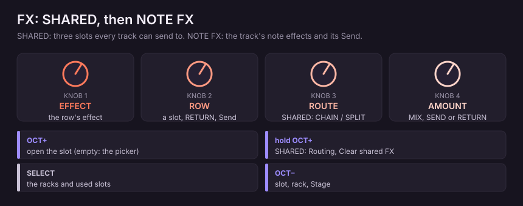

| Control | Does |
|---|---|
| **FX** | SHARED rack; again (or **SELECT**): the track's NOTE FX rack |
| **KNOB 2 / PRESETS** | Pick a row (SHARED: slots A–C or RETURN) |
| **KNOB 1** | The row's effect |
| **KNOB 3** (SHARED) | ROUTE: CHAIN or SPLIT |
| **KNOB 4** | Its amount (MIX, SEND or RETURN) |
| **OCT+** | Open the slot (empty: its effect picker; Send row: SHARED) |
| **hold OCT+** (SHARED) | Routing, Clear shared FX |
| **OCT−** | Slot → rack → Stage |

## Scales and chords (SCL)

| Page | Controls |
|---|---|
| **SCALES** | **KNOB 1** family (ALL / FAV), **KNOB 2** scale, ROOT, QNT; **PRESETS** also browses |
| **SCL** | ROOT, favourite, QNT, TRN |
| **CHORD** | CHRD, VOIC, STRUM, STROKE |

## Arpeggiator (ARP)

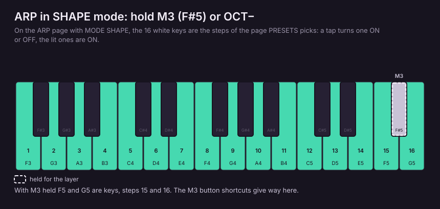

| Control | Does |
|---|---|
| **ARP / ARP 2 knobs** | MODE RATE OCTAVE GATE / SWG PROB HOLD ORD |
| **SHAPE mode: hold M3 or OCT−** | The white keys are the steps: tap one ON or OFF; **PRESETS** picks the page of steps |

## Sequencer (SEQ)

**SEQ** again, or **SELECT**: NOTES, PATTERN, TEMPO, PATTERNS, SONG, MOTION (once it has data), DRUM HIT (drum tracks).

### NOTES

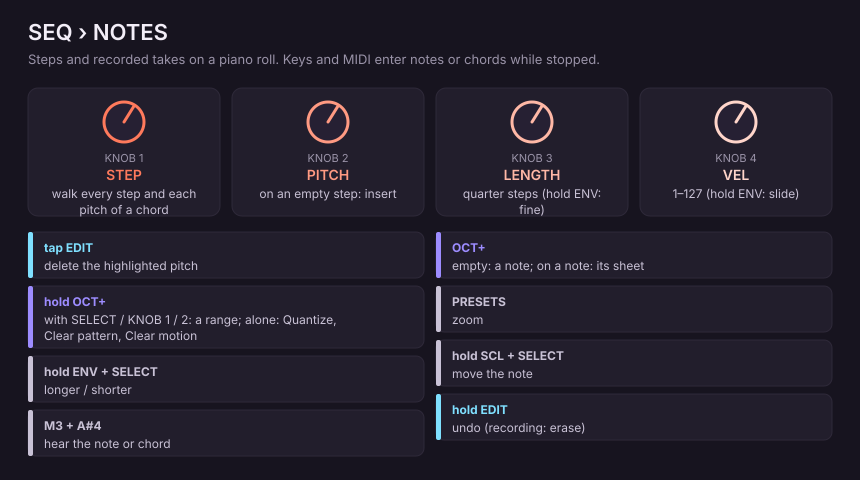

| Control | Does |
|---|---|
| **KNOB 1** | Walk the steps (empty ones too, each pitch of a chord) |
| **KNOB 2** | Pitch; on an empty step, insert a note |
| **KNOB 3** | Length, in quarter steps (**hold ENV**: fine, on recorded notes) |
| **KNOB 4** | Velocity (**hold ENV**: SLIDE on a manual note) |
| **keys / MIDI** (stopped) | Enter notes or chords; the cursor moves on when released |
| **PRESETS** | Zoom |
| **hold SCL + SELECT / KNOB 1** | Move the highlighted note |
| **hold ENV + SELECT / KNOB 1** | Make it longer / shorter |
| **tap EDIT** | Delete the highlighted pitch (a recorded note too) |
| **hold EDIT** while recording | Erase under the playhead (ERASING) |
| **OCT+** | Empty: place a note. On a note: Length, Velocity, Chance, Slide, Move note, Copy note, Delete note |
| **hold OCT+ + SELECT / KNOB 1 / KNOB 2** | Select a range; **KNOB 1** moves it; tap **OCT+**: Copy, Quantize, Delete selected, Clear selection |
| **hold OCT+** (no range) | Quantize, Clear pattern, Clear motion |
| **M3 + A#4** | Hear the note or chord at the cursor |

### Drum grid (NOTES on a drum track)

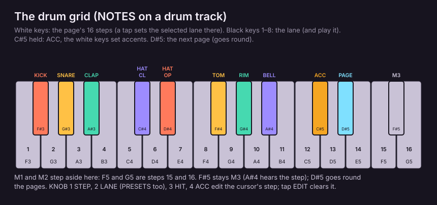

| Control | Does |
|---|---|
| **white keys** | The page's 16 steps: a tap sets the selected lane there |
| **black keys 1–8** (F#3 … A#4) | Pick the lane (KICK SNARE CLAP HATCL HATOP TOM RIM BELL) |
| **C#5 held** | ACC: the white keys set accents |
| **D#5** | The next page (goes round) |
| **KNOB 1–4** | STEP, LANE, HIT, ACC of the cursor's step (**PRESETS**: the lane too) |
| **tap EDIT** | Clear the step (STEP CLEARED) |
| **hold OCT+** | The pattern sheet; **Drum view** switches Grid / Notes (the piano roll) |

On the drum grid M1 and M2 step aside: F5 and G5 are steps 15 and 16. F#5 stays M3 (so M3 + A#4 still hears the
step); D#5 goes round the pages.

### PATTERN and TEMPO

| Page | Knobs |
|---|---|
| **PATTERN** | LEN DIV SWG GATE (this track) |
| **TEMPO** | BPM, SWG (song), QNT (the recording grid) |

### Pattern keys (any page)

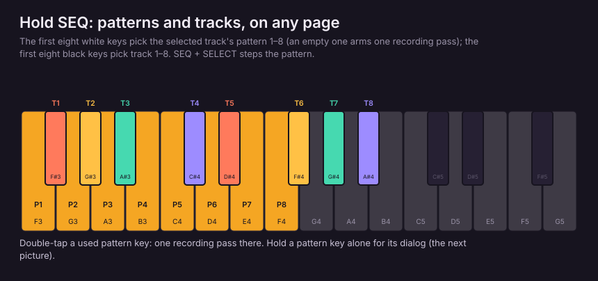

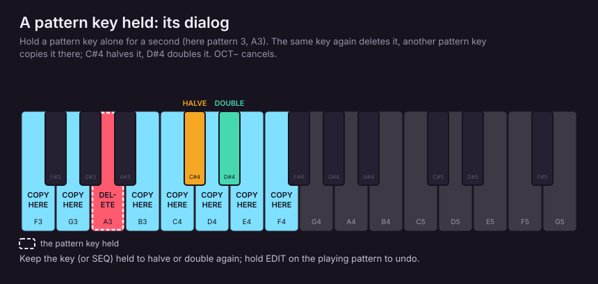

| Control | Does |
|---|---|
| **SEQ + first eight white keys** | Select pattern 1–8 (an empty one arms one recording pass) |
| **SEQ + SELECT** | Next / previous pattern |
| **SEQ + first eight black keys** | Select track 1–8 |
| **double-tap a used pattern key** | Arm one recording pass there |
| **hold a pattern key** | Its dialog: the same key deletes, another key copies there, **C#** halves, **D#** doubles, **OCT−** cancels |

### PATTERNS

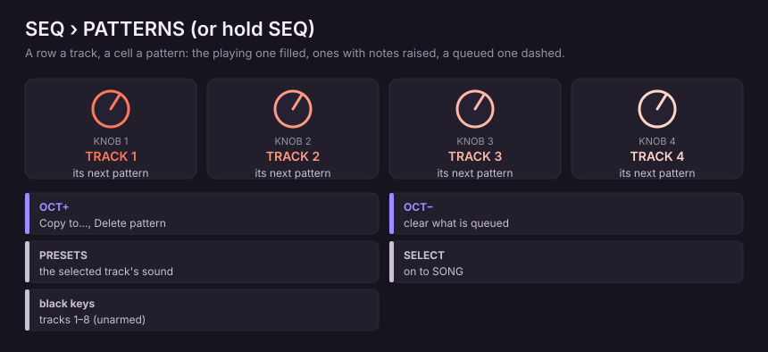

| Control | Does |
|---|---|
| **KNOB 1–4** | Queue a pattern for tracks 1–4 |
| **black keys** (unarmed) | Select tracks 1–8 |
| **PRESETS** | Change the selected audio track's sound |
| **OCT+** | Copy to…, Delete pattern |
| **OCT−** | Clear what is queued |
| **SELECT** | On to SONG |

### SONG

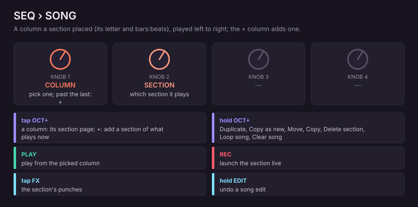

| Control | Does |
|---|---|
| **KNOB 1** | Pick a column (past the last: the **+** column) |
| **KNOB 2** | Which section the column plays |
| **tap OCT+** | On a column: its section page. On **+**: add a section of what every track plays now |
| **hold OCT+** | Duplicate section, Copy as new section, Move section, Copy section, Delete section, Loop song, Clear song |
| **hold OCT+ + KNOB 1** | Select columns; tap **OCT+** to copy, move, duplicate or delete them |
| **PLAY** | Play from the picked column (on **+**: from the first) |
| **REC** | Launch the picked section live |
| **tap FX** | The section's master punches |
| **hold FX** | The live punch layer |
| **hold EDIT** | Undo a song edit |

### Section page (OCT+ on a column)

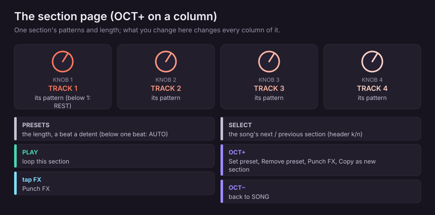

| Control | Does |
|---|---|
| **KNOB 1–4** | Each track's pattern (below the first: REST) |
| **PRESETS** | Length, a beat a detent (below one beat: AUTO) |
| **SELECT** | The song's next / previous section (A, B, C …), stopping at the first and last; header k/n |
| **PLAY** | Loop this section |
| **OCT+** | Set preset, Remove preset, Punch FX, Copy as new section |
| **tap FX** | Punch FX |
| **OCT−** | Back to SONG |

### Punch editor

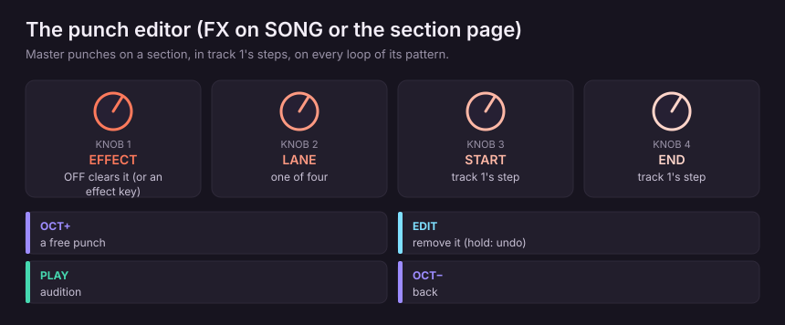

| Control | Does |
|---|---|
| **an effect key / KNOB 1** | The effect (KNOB 1 to OFF clears it) |
| **KNOB 2 / PRESETS** | One of four lanes |
| **KNOB 3 / KNOB 4** | START / END, in track 1's steps |
| **OCT+** | A free punch |
| **EDIT** | Remove the punch (hold: undo) |
| **PLAY** | Audition |
| **OCT−** | Back |

### MOTION

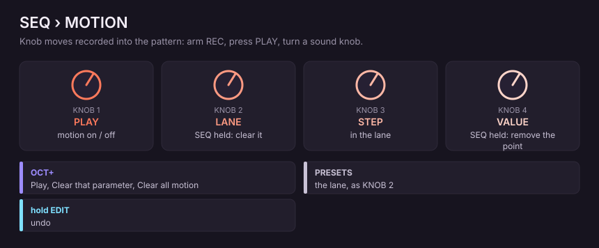

| Control | Does |
|---|---|
| **KNOB 1** | Motion playback on / off |
| **KNOB 2 / PRESETS** | Lane (**SEQ + KNOB 2**: clear the lane) |
| **KNOB 3** | Step |
| **KNOB 4** | Value (**SEQ + KNOB 4**: remove the point) |
| **OCT+** | Play, Clear that parameter, Clear all motion |

Record motion: arm **REC**, press **PLAY**, turn a sound knob.

## Global (GLO)

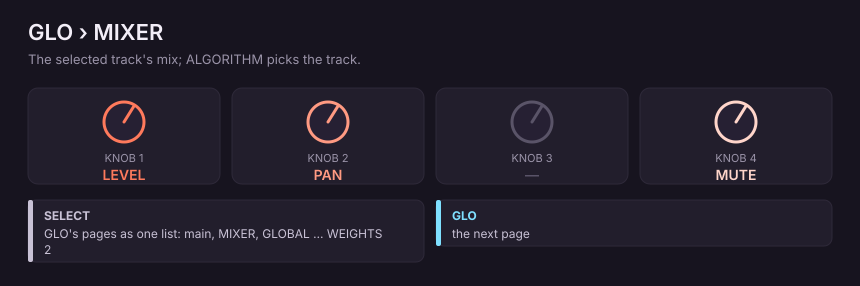

| Page | Controls |
|---|---|
| **main page** | Mutes, solos, TAP, levels: see the GLO layer above |
| **MIXER** | **KNOB 1** level, **KNOB 2** pan, **KNOB 4** mute (selected track) |
| **GLOBAL** | **KNOB 1** A4 pitch, **KNOB 2** BUDGET, **KNOB 3** CLK, **KNOB 4** TUNE |
| **SYSTEM** | MIDI input, DRUM channel, ROUT, CPU info |

## Menu (hold HOME)

**KNOB 2** or **PRESETS** picks the row (stopping at the first and last); **KNOB 1** or **OCT+** changes it. Among the
settings:

| Item | Does |
|---|---|
| **NOTE PREVIEW** | ON: hear notes as you edit. OFF: only **M3 + A#4** |
| **CHORD ENTRY** | HOLD (press together) or ADD (tap one by one) |
| **HOME SELECT / GLO SELECT** | What SELECT turns on Stage / with GLO held |
| **HOLD** | How long a hold is |
| **PICKER POPUPS** | Name lists as a picker, or on the knob |
| **KNOB ACCEL** | Off: every detent one step |
| **AUTOSAVE** | Save a changed project after five seconds untouched |
