# PATTERNS and SONG, step by step

How to choose patterns, build a song out of sections, edit and move them, and play it live. Each step is one
picture: the screen with numbered marks, and what to press. The full reference is the user manual
([`web/manual/index.html`](../../web/manual/index.html): "Patterns, sections and songs", "Patterns" and
"Songs"); the design notes are in [`docs/design/README.md`](../design/README.md) "SONG sections".

The pictures are drawings of the device's screens, made by `tools/gen_song_guide.py`; run it again after the
screens change.

**The words:** a *pattern* is one track's loop, shown everywhere as its number (1-16) in the track's colour. A
*section* is one part of the song, shown as its letter (A-Z): the
pattern or a rest (REST) for every track, and a length (on SONG's cards bars:beats: 2:3 is 2 bars 3 beats). The
*song* is sections in columns, left to right; a section can be placed in as many columns as you like, and
they all play the same. A *track* is its numbered chip at the left of each row.

## Contents

- **PATTERNS**
  - [1. Open PATTERNS](#1-open-patterns)
  - [2. Choose what each track plays](#2-choose-what-each-track-plays)
  - [3. Copy or delete a pattern](#3-copy-or-delete-a-pattern)
- **SONG**
  - [4. Go to SONG](#4-go-to-song)
  - [5. Add your first section (A)](#5-add-your-first-section-a)
  - [6. Add more sections](#6-add-more-sections)
  - [7. Read the SONG grid](#7-read-the-song-grid)
  - [8. Change which section a column plays](#8-change-which-section-a-column-plays)
- **SECTION PAGE**
  - [9. Open a section](#9-open-a-section)
  - [10. Change the section's patterns](#10-change-the-sections-patterns)
  - [11. Set the section's length](#11-set-the-sections-length)
  - [12. Hear just this section](#12-hear-just-this-section)
  - [13. Sounds, punches, a copy](#13-sounds-punches-a-copy)
- **SONG**
  - [14. Make a variation of a section](#14-make-a-variation-of-a-section)
  - [15. Move a section](#15-move-a-section)
  - [16. Delete a column](#16-delete-a-column)
  - [17. Work on several columns](#17-work-on-several-columns)
  - [18. Play the song](#18-play-the-song)
  - [19. Launch sections live](#19-launch-sections-live)
  - [20. Undo and redo](#20-undo-and-redo)

## PATTERNS

### 1. Open PATTERNS

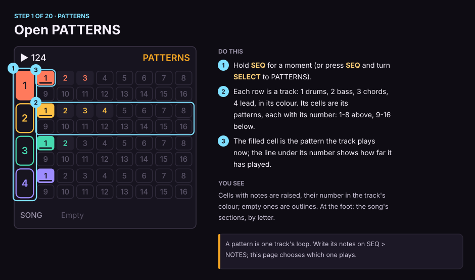

1. Hold **SEQ** for a moment (or press **SEQ** and turn **SELECT** to PATTERNS).
2. Each row is a track: 1 drums, 2 bass, 3 chords, 4 lead, in its colour. Its cells are its patterns: 1-8 above, 9-16 below.
3. The filled cell is the pattern the track plays now; the line under its number shows how far it has played.

*You see:* Cells with notes are raised, their number in the track's colour; empty patterns are plain outlines, no number. At the foot: the song's sections, by letter.

> A pattern is one track's loop. Write its notes on SEQ > NOTES; this page chooses which one plays.

### 2. Choose what each track plays

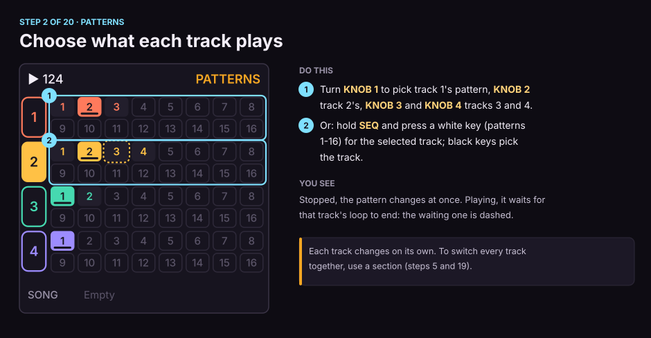

1. Turn **KNOB 1** to pick track 1's pattern, **KNOB 2** track 2's, **KNOB 3** and **KNOB 4** tracks 3 and 4.
2. Or: hold **SEQ** and press a white key (patterns 1-16) for the selected track; black keys pick the track.

*You see:* Stopped, the pattern changes at once. Playing, it waits for that track's loop to end: the waiting one is dashed.

> Each track changes on its own. To switch every track together, use a section (steps 5 and 19).

### 3. Copy or delete a pattern

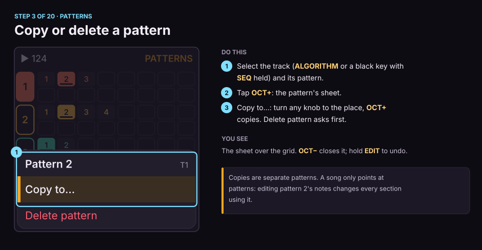

1. Select the track (**ALGORITHM** or a black key with **SEQ** held) and its pattern.
2. Tap **OCT+**: the pattern's sheet.
3. Copy to…: turn any knob to the place, **OCT+** copies. Delete pattern asks first.

*You see:* The sheet over the grid. **OCT−** closes it; hold **EDIT** to undo.

> Copies are separate patterns. A song only points at patterns: editing pattern 2's notes changes every section using it.

## SONG

### 4. Go to SONG

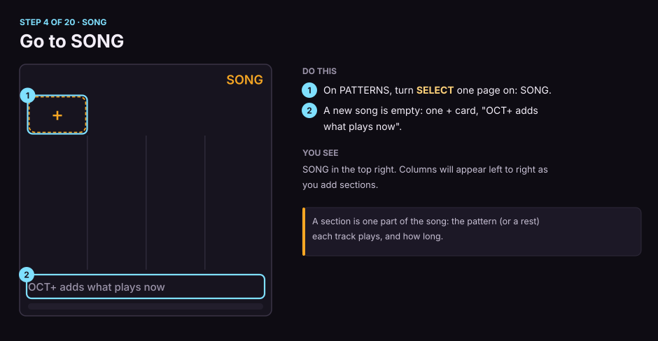

1. On PATTERNS, turn **SELECT** one page on: SONG.
2. A new song is empty: one + card, "OCT+ adds what plays now".

*You see:* SONG in the top right. Columns will appear left to right as you add sections.

> A section is one part of the song: the pattern (or a rest) each track plays, and how long.

### 5. Add your first section (A)

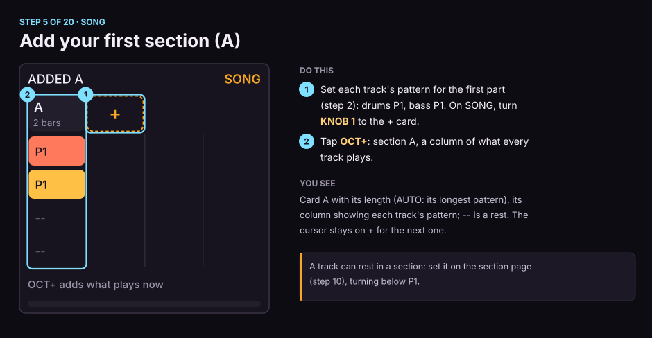

1. Set each track's pattern for the first part (step 2): drums 1, bass 1. On SONG, turn **KNOB 1** to the + card.
2. Tap **OCT+**: section A, a column of what every track plays.

*You see:* Card A with its length in bars:beats (2:0, two bars: AUTO, its longest pattern), its column showing each track's pattern number; REST is a resting track. The cursor stays on + for the next one.

> A track can rest in a section: set it on the section page (step 10), turning below pattern 1.

### 6. Add more sections

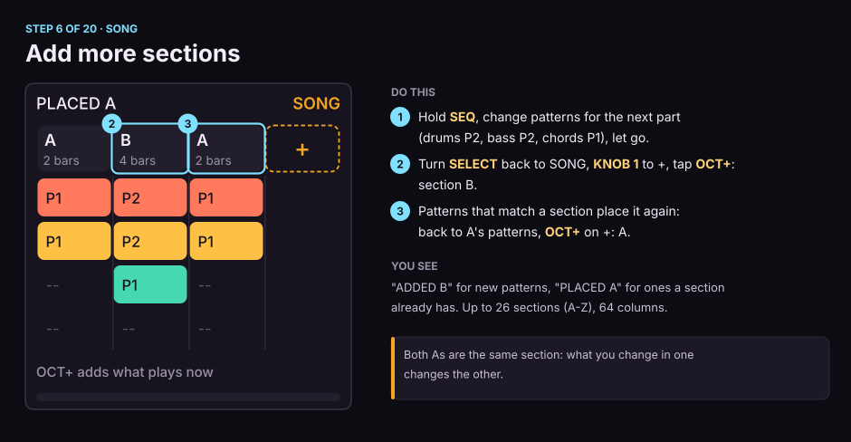

1. Hold **SEQ**, change patterns for the next part (drums 2, bass 2, chords 1), let go.
2. Turn **SELECT** back to SONG, **KNOB 1** to +, tap **OCT+**: section B.
3. Patterns that match a section place it again: back to A's patterns, **OCT+** on +: A.

*You see:* "ADDED B" for new patterns, "PLACED A" for ones a section already has. Up to 26 sections (A-Z), 64 columns.

> Both As are the same section: what you change in one changes the other.

### 7. Read the SONG grid

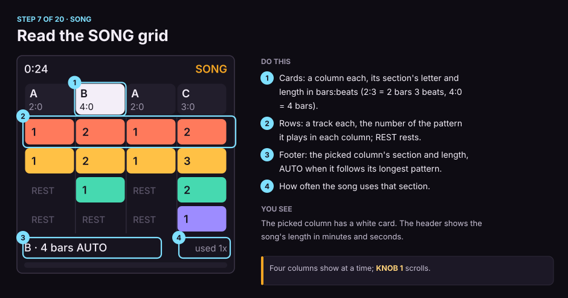

1. Cards: a column each, its section's letter and length in bars:beats (2:3 = 2 bars 3 beats, 4:0 = 4 bars).
2. Rows: a track each, the number of the pattern it plays in each column; REST rests.
3. Footer: the picked column's section and length, AUTO when it follows its longest pattern.
4. How often the song uses that section.

*You see:* The picked column has a white card. The header shows the song's length in minutes and seconds.

> Four columns show at a time; **KNOB 1** scrolls.

### 8. Change which section a column plays

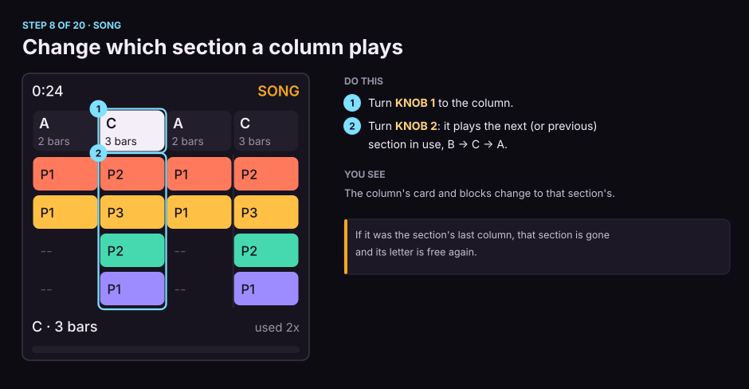

1. Turn **KNOB 1** to the column.
2. Turn **KNOB 2**: it plays the next (or previous) section in use, B -> C -> A.

*You see:* The column's card and blocks change to that section's.

> If it was the section's last column, that section is gone and its letter is free again.

## SECTION PAGE

### 9. Open a section

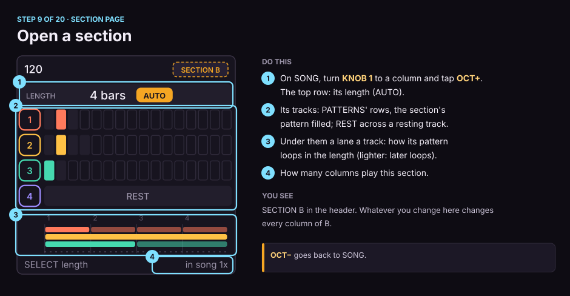

1. On SONG, turn **KNOB 1** to a column and tap **OCT+**. The top row: its length in words (AUTO).
2. Its tracks: PATTERNS' numbered cells, the section's pattern filled; REST across a resting track.
3. At the foot a lane a track: how its pattern loops in the length (lighter: later loops).
4. How many columns play this section.

*You see:* SECTION B in the header. Whatever you change here changes every column of B.

> **OCT−** goes back to SONG.

### 10. Change the section's patterns

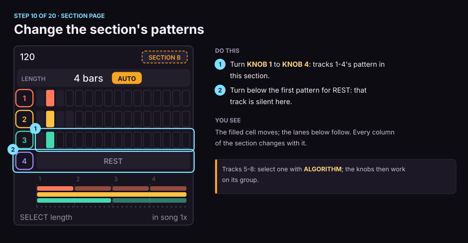

1. Turn **KNOB 1** to **KNOB 4**: tracks 1-4's pattern in this section.
2. Turn below the first pattern for REST: that track is silent here.

*You see:* The filled cell moves; the lanes below follow. Every column of the section changes with it.

> Tracks 5-8: select one with **ALGORITHM**; the knobs then work on its group.

### 11. Set the section's length

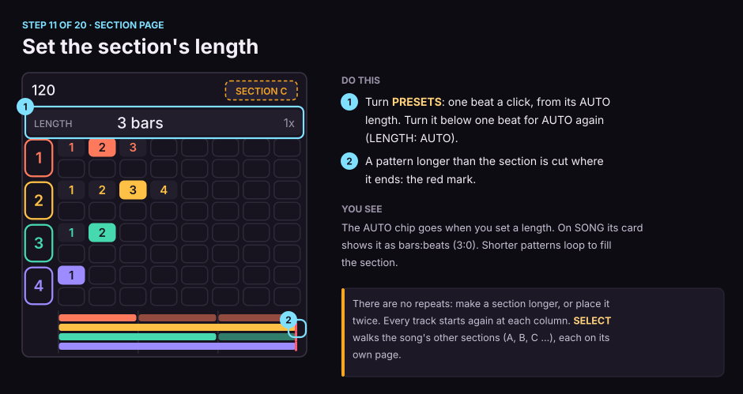

1. Turn **PRESETS**: one beat a click, from its AUTO length. Turn it below one beat for AUTO again (LENGTH: AUTO).
2. A pattern longer than the section is cut where it ends: the red mark.

*You see:* The AUTO chip goes when you set a length. On SONG its card shows it as bars:beats (3:0). Shorter patterns loop to fill the section.

> There are no repeats: make a section longer, or place it twice. Every track starts again at each column. **SELECT** walks the song's other sections (A, B, C …), each on its own page.

### 12. Hear just this section

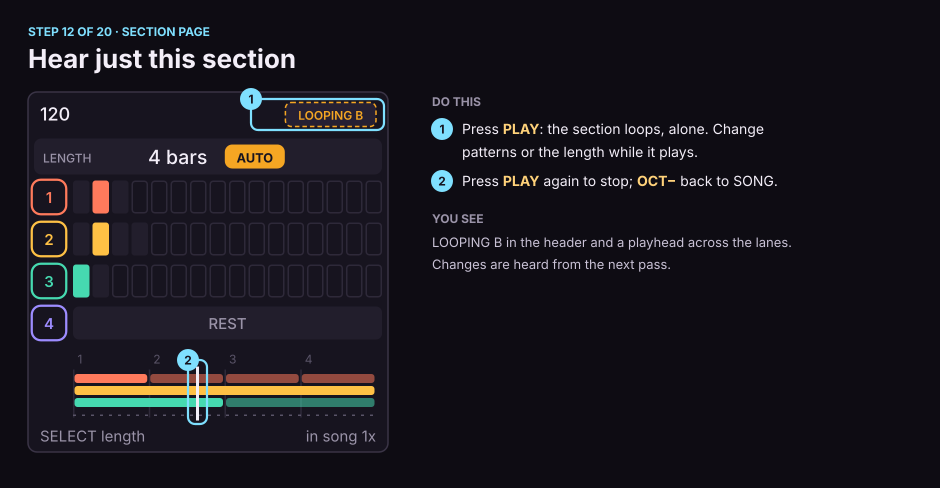

1. Press **PLAY**: the section loops, alone. Change patterns or the length while it plays.
2. Press **PLAY** again to stop; **OCT−** back to SONG.

*You see:* LOOPING B in the header and a playhead across the lanes. Changes are heard from the next pass.

### 13. Sounds, punches, a copy

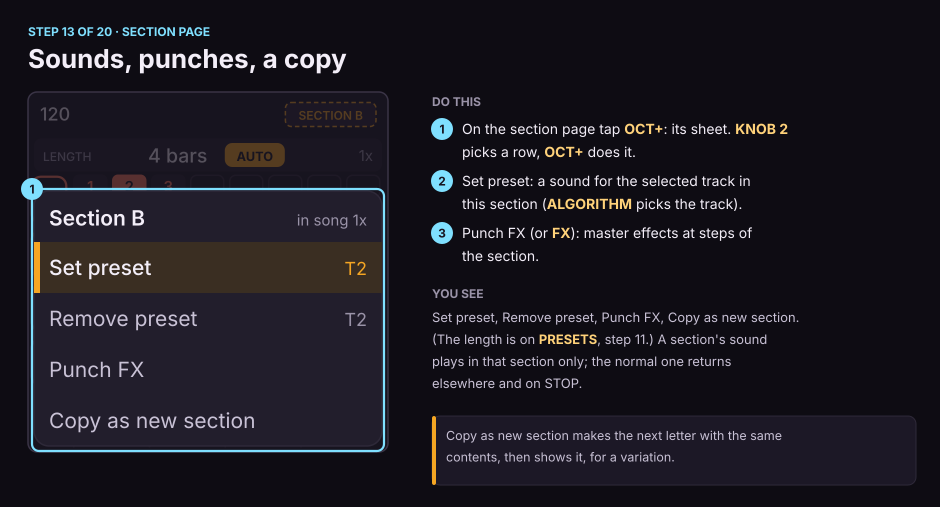

1. On the section page tap **OCT+**: its sheet. **KNOB 2** picks a row, **OCT+** does it.
2. Set preset: a sound for the selected track in this section (**ALGORITHM** picks the track).
3. Punch FX (or **FX**): master effects at steps of the section.

*You see:* Set preset, Remove preset, Punch FX, Copy as new section. (The length is on **PRESETS**, step 11.) A section's sound plays in that section only; the normal one returns elsewhere and on STOP.

> Copy as new section makes the next letter with the same contents, then shows it, for a variation.

## SONG

### 14. Make a variation of a section

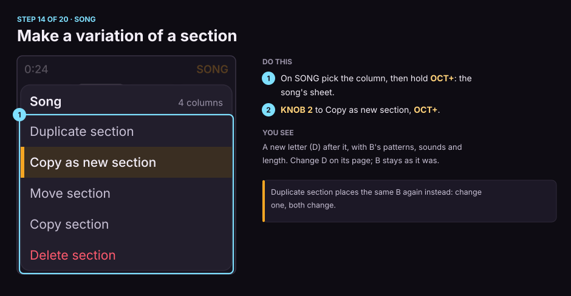

1. On SONG pick the column, then hold **OCT+**: the song's sheet.
2. **KNOB 2** to Copy as new section, **OCT+**.

*You see:* A new letter (D) after it, with B's patterns, sounds and length. Change D on its page; B stays as it was.

> Duplicate section places the same B again instead: change one, both change.

### 15. Move a section

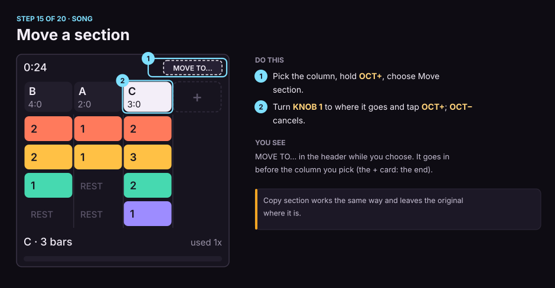

1. Pick the column, hold **OCT+**, choose Move section.
2. Turn **KNOB 1** to where it goes and tap **OCT+**; **OCT−** cancels.

*You see:* MOVE TO... in the header while you choose. It goes in before the column you pick (the + card: the end).

> Copy section works the same way and leaves the original where it is.

### 16. Delete a column

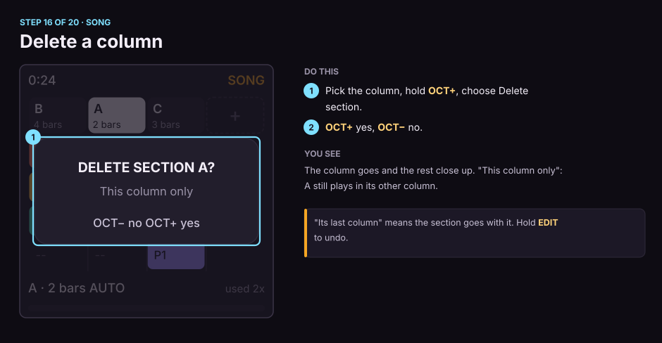

1. Pick the column, hold **OCT+**, choose Delete section.
2. **OCT+** yes, **OCT−** no.

*You see:* The column goes and the rest close up. "This column only": A still plays in its other column.

> "Its last column" means the section goes with it. Hold **EDIT** to undo.

### 17. Work on several columns

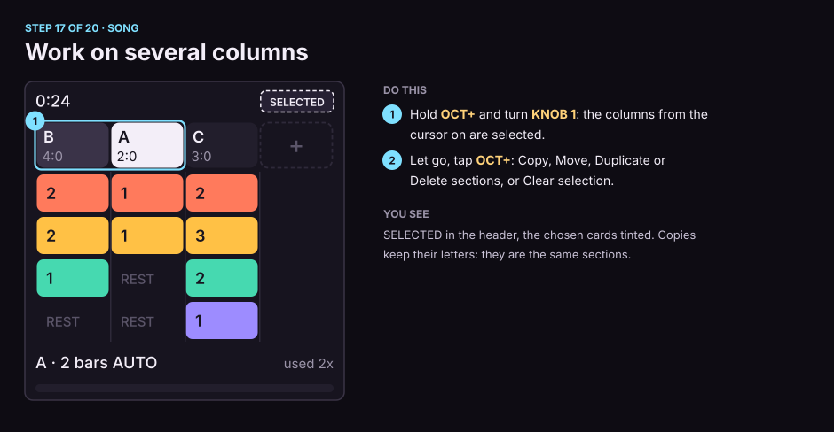

1. Hold **OCT+** and turn **KNOB 1**: the columns from the cursor on are selected.
2. Let go, tap **OCT+**: Copy, Move, Duplicate or Delete sections, or Clear selection.

*You see:* SELECTED in the header, the chosen cards tinted. Copies keep their letters: they are the same sections.

### 18. Play the song

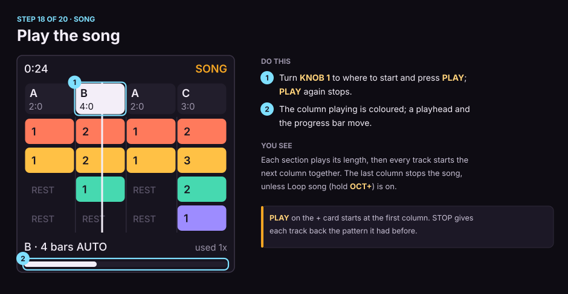

1. Turn **KNOB 1** to where to start and press **PLAY**; **PLAY** again stops.
2. The column playing is coloured; a playhead and the progress bar move.

*You see:* Each section plays its length, then every track starts the next column together. The last column stops the song, unless Loop song (hold **OCT+**) is on.

> **PLAY** on the + card starts at the first column. STOP gives each track back the pattern it had before.

### 19. Launch sections live

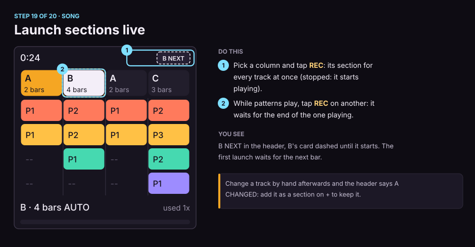

1. Pick a column and tap **REC**: its section for every track at once (stopped: it starts playing).
2. While patterns play, tap **REC** on another: it waits for the end of the one playing.

*You see:* B NEXT in the header, B's card dashed until it starts. The first launch waits for the next bar.

> Change a track by hand afterwards and the header says A CHANGED: add it as a section on + to keep it.

### 20. Undo and redo

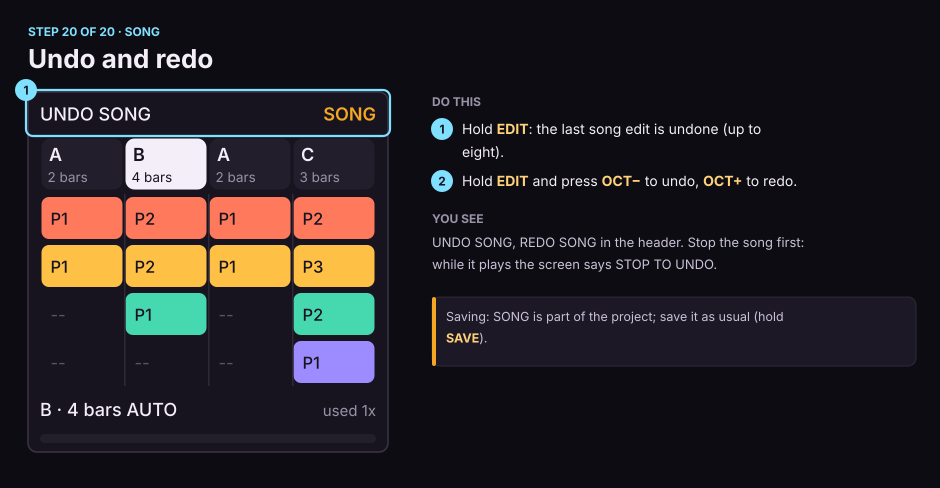

1. Hold **EDIT**: the last song edit is undone (up to eight).
2. Hold **EDIT** and press **OCT−** to undo, **OCT+** to redo.

*You see:* UNDO SONG, REDO SONG in the header. Stop the song first: while it plays the screen says STOP TO UNDO.

> Saving: SONG is part of the project; save it as usual (hold **SAVE**).

## Quick reference

| Where | Control | Does |
| --- | --- | --- |
| PATTERNS | KNOB 1-4 | each track's pattern (playing: at its loop end) |
| PATTERNS | SEQ held + white key | the selected track's pattern |
| PATTERNS | OCT+ | the pattern's sheet: Copy to..., Delete pattern |
| PATTERNS | SELECT | on to SONG |
| SONG | KNOB 1 | pick a column (past the last: +) |
| SONG | KNOB 2 | which section the column plays |
| SONG | OCT+ | on a column: its section page; on +: add what plays now |
| SONG | OCT+ held | Duplicate, Copy as new, Move, Copy, Delete section; Loop song; Clear song |
| SONG | OCT+ held + KNOB 1 | select several columns, then OCT+ for their sheet |
| SONG | PLAY | play from the picked column / stop |
| SONG | REC | launch the picked column's section live |
| SONG | FX | the picked section's master punches |
| SONG | EDIT held | undo (EDIT + OCT- / OCT+: undo / redo) |
| Section page | KNOB 1-4 | tracks 1-4's pattern in the section (below pattern 1: REST) |
| Section page | PRESETS | its length, a beat a click (below a beat: AUTO) |
| Section page | SELECT | the song's next / previous section (stops at the first and last) |
| Section page | PLAY | loop just this section / stop |
| Section page | OCT+ | Set / Remove preset, Punch FX, Copy as new section |
| Section page | OCT- | back to SONG |
